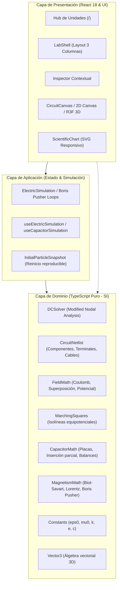
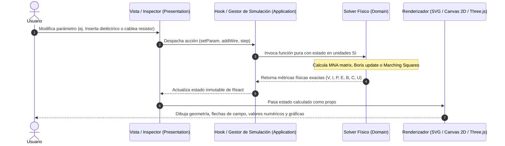

# Arquitectura de Software — Laboratorio Vectorial

## 1. Principios de Diseño
El simulador implementa una **Clean Architecture pragmática** adaptada a aplicaciones web de simulación científica en TypeScript y React 18:
1. **Independencia del Dominio Físico:** Todas las fórmulas, ecuaciones diferenciales, constantes y solvers residen en la capa `domain/` en TypeScript puro, sin dependencias de React, DOM ni Three.js.
2. **Flujo Unidireccional de Datos:** La UI captura interacciones del usuario (modificación de sliders, arrastre de piezas, cableado), las despacha a los casos de uso / solvers de aplicación, y renderiza exclusivamente el estado físico calculado.
3. **Unidades Estrictas del Sistema Internacional (SI):** El motor interno opera exclusivamente en voltios (V), amperios (A), ohmios ($\Omega$), culombios (C), teslas (T), metros (m), kilogramos (kg) y segundos (s). Las conversiones didácticas a submúltiplos ($\mu\text{C}, \text{pF}, \text{mm}$) se aplican únicamente en el borde de presentación (entrada y salida visual).
4. **Resiliencia Gráfica:** Desacoplamiento entre la simulación y el motor de render. Si WebGL falla o no está soportado, el dominio continúa intacto y el lienzo conmuta automáticamente al renderizador 2D SVG/Canvas.

---

## 2. Diagrama de Capas Arquitectónicas

---

## 3. Flujo del Cálculo: De la Interacción al Renderizado

---

## 4. Detalle de los Módulos de Dominio

### 4.1. U1: Dominio de Electrostática (`src/modules/electric/domain`)
- **`FieldMath.ts`:**
  - Campo por superposición lineal: $\vec{E}(\vec{r}) = \frac{1}{4\pi\varepsilon_0} \sum \frac{q_i (\vec{r} - \vec{r}_i)}{|\vec{r} - \vec{r}_i|^3}$.
  - Potencial escalar: $V(\vec{r}) = \frac{1}{4\pi\varepsilon_0} \sum \frac{q_i}{|\vec{r} - \vec{r}_i|}$.
  - Detección estricta de singularidades en $|\vec{r} - \vec{r}_i| < 10^{-6}\text{ m}$.
- **`MarchingSquares.ts`:**
  - Extracción continua de isolíneas a partir de una cuadrícula regular de potencial $V(x, y)$ con interpolación lineal en los bordes de celda.
- **`ElectricSimulation.ts`:**
  - Integrador Euler-Cromer acoplado a `InitialParticleSnapshot` que almacena $\{\vec{r}_0, \vec{v}_0, q, m\}$ para reinicio estricto e indistinguible.

### 4.2. U2: Dominio de Capacitores (`src/modules/capacitors/domain`)
- **`CapacitorMath.ts`:**
  - Capacitancia en vacío: $C_{vac} = \frac{\varepsilon_0 A}{d}$.
  - Inserción parcial con fracción $f \in [0, 1]$: $C_{eq} = C_{vac} [ 1 + (\varepsilon_r - 1) f ]$.
  - Balance en modo $V$ fijo: $Q = C V$, $U = \frac{1}{2} C V^2$, trabajo cedido por batería $W_{bat} = V \cdot \Delta Q = 2 \Delta U$.
  - Balance en modo $Q$ fijo: $V = Q / C$, $U = \frac{Q^2}{2 C}$ (el campo realiza trabajo sobre la lámina dieléctrica).
  - Fuerza atractiva sobre la lámina: $F_{slab} = \frac{1}{2} (\varepsilon_r - 1) \varepsilon_0 W \frac{V^2}{d}$.

### 4.3. U3: Dominio de Circuitos DC (`src/modules/current/domain`)
- **`CircuitNetlist.ts`:**
  - Define interfaces atómicas: `CircuitComponent`, `Terminal`, `Wire`, `CircuitNetlist`, `ComponentSimulationResult`.
- **`DCSolver.ts`:**
  - Extracción topológica de nodos mediante bosque Disjoint-Set.
  - Matriz MNA:
    $$\begin{pmatrix} G & B \\ C & D \end{pmatrix} \begin{pmatrix} v \\ j \end{pmatrix} = \begin{pmatrix} i \\ e \end{pmatrix}$$
  - Solución mediante Eliminación Gaussiana con pivoteo parcial.
  - Conservación estricta de potencia: $\sum P_{in} = \sum P_{out}$.

### 4.4. U4: Dominio de Magnetismo (`src/modules/magnetism/domain`)
- **`MagnetismMath.ts`:**
  - Biot-Savart para hilo infinito: $\vec{B} = \frac{\mu_0 I}{2\pi r} (\hat{u}_I \times \hat{u}_r)$.
  - Dipolo magnético: $\vec{B}(\vec{r}) = \frac{\mu_0}{4\pi r^3} [ 3(\vec{m}\cdot\hat{r})\hat{r} - \vec{m} ]$.
  - **Boris Pusher:** Algoritmo simpléctico canónico:
    $$\vec{v}^- = \vec{v}^t + \frac{q\vec{E}}{m}\frac{\Delta t}{2}$$
    $$\vec{v}' = \vec{v}^- + \vec{v}^- \times \vec{t}, \quad \vec{t} = \frac{q\vec{B}}{m}\frac{\Delta t}{2}$$
    $$\vec{v}^+ = \vec{v}^- + \vec{v}' \times \vec{s}, \quad \vec{s} = \frac{2\vec{t}}{1 + |\vec{t}|^2}$$
    $$\vec{v}^{t+\Delta t} = \vec{v}^+ + \frac{q\vec{E}}{m}\frac{\Delta t}{2}$$
    $$\vec{x}^{t+\Delta t} = \vec{x}^t + \vec{v}^{t+\Delta t} \Delta t$$
  - Garantiza que cuando $\vec{E} = 0$, $|\vec{v}^{t+\Delta t}| \equiv |\vec{v}^t|$.
